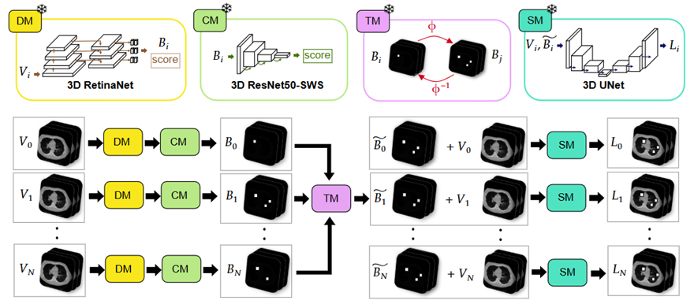

# NoduleFlow: Automatic 3D Longitudinal Lung Nodule Detection and Segmentation

Official implementation of the CIBB 2026 paper *"NoduleFlow: Automatic 3D
Longitudinal Lung Nodule Detection and Segmentation"* (G. Romoli, F. Ruffini,
F. Di Feola, V. Guarrasi, M. Tortora, P. Soda).

NoduleFlow detects, classifies and segments lung nodules directly from a
series of CT volumes of the same patient. It needs no lesion annotations,
manual initialisation or ROI pre-selection at inference time.



*For each CT scan V<sub>i</sub>, a Detection Module (DM) and a Classification
Module (CM) produce candidate nodule boxes B<sub>i</sub>. A Transfer Module (TM)
propagates the candidates across time points through inter-scan registration
fields, giving refined prompts B̃<sub>i</sub>. These prompts and the original CT
go to the Segmentation Module (SM), which outputs the nodule mask L<sub>i</sub>.*

## Modules

| Module | Model | Code |
|---|---|---|
| DM: detection | 3D RetinaNet (DLCS- or LUNA16-trained), optional ensemble | `src/modules/detection` |
| CM: classification | 3D ResNet50-SWS malignancy classifier | `src/modules/classification` |
| TM: transfer | uniGradICON registration + candidate propagation | `src/modules/registration`, `src/longitudinal.py` |
| SM: segmentation | LesionLocator, box or point prompts | `src/modules/segmentation` |

All components are used **frozen**, as released by their authors.

The TM supports three propagation strategies, set by `longitudinal.strategy`
in `configs/config.yaml`:

- **S0**: no propagation. Each time point uses only its own detections.
- **S1**: candidates from the current and earlier time points. Suitable for
  prospective or clinical use.
- **S2**: candidates from all time points. For retrospective analysis.

## Installation

```bash
git clone https://github.com/gromoli94/NoduleFlow-public.git
cd NoduleFlow-public
python -m venv .venv && source .venv/bin/activate
pip install -r requirements.txt
```

## Network weights

Put the weights under `network_weights/` (the path is set by
`network_weights_dir` in `configs/config.yaml`):

```
network_weights/
├── DLCSD-mD/                  # RetinaNet trained on DLCS
├── LUNA16-mD/                 # RetinaNet trained on LUNA16
├── resnet50WSPP/              # ResNet50-SWS classifier
├── LesionLocatorCheckpoint/   # LesionLocator (from its authors' release)
└── unigradicon1.0/            # downloaded automatically on first use
```

<!-- TODO: add download links for each checkpoint -->

## Usage

```python
import yaml
from src.pipeline import Pipeline                  # single scan
from src.longitudinal import LongitudinalPipeline  # series of scans

cfg = yaml.safe_load(open("configs/config.yaml"))
```

See `test/test_pipeline.py` (single scan) and `test/test_longitudinal.py`
(T0/T1/T2 series with S0/S1/S2 propagation) for complete examples. The tests
expect example volumes `test/example_T{0,1,2}.nii.gz`, which are not
distributed. Point them at your own CT series.

Module configuration (thresholds, ensemble, prompt type, propagation strategy)
lives in `configs/config.yaml` and `configs/modules/`.

## Citation

```bibtex
@inproceedings{romoli2026noduleflow,
  title     = {NoduleFlow: Automatic 3D Longitudinal Lung Nodule Detection and Segmentation},
  author    = {Romoli, Giulia and Ruffini, Filippo and Di Feola, Francesco and
               Guarrasi, Valerio and Tortora, Matteo and Soda, Paolo},
  booktitle = {Proceedings of CIBB 2026},
  year      = {2026}
}
```

## Acknowledgements

NoduleFlow builds on
[LesionLocator](https://github.com/MIC-DKFZ/LesionLocator),
[uniGradICON](https://github.com/uncbiag/uniGradICON) and
[MONAI](https://github.com/Project-MONAI/MONAI). Please also cite those works.
